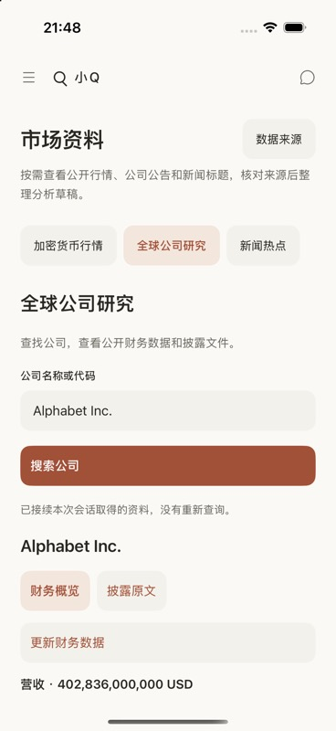
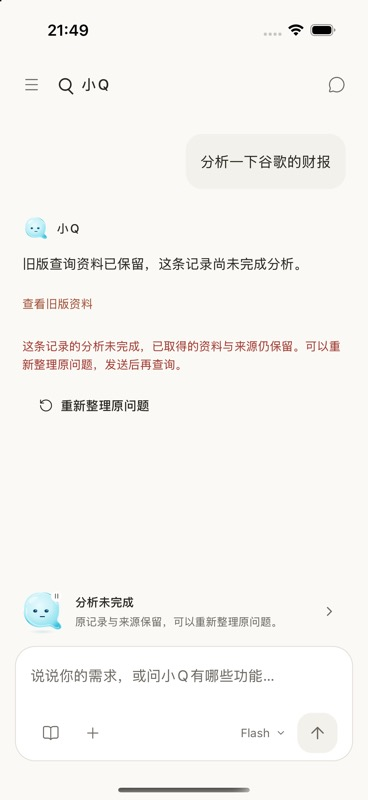
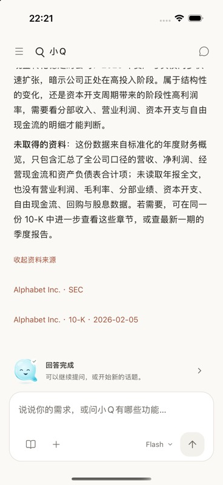

# 对话研究闭环与展示修复

2026-11-09。基线为 GitHub main `a52bb73`，与 GitLab main `60fd730` 同树。本记录对应本次源码与隔离联调，不表示正式服务器、TestFlight 或桌面上此前交付的 APK 已更新。

## 问题与修复

- 真实 DeepSeek 在 `parallel_tool_calls:false` 下仍可能分段返回两个查询。旧解析器遇到第二个索引就中断整轮。应用模式现在有界接收最多三项，全部验证后只交付第一项，下一轮根据实际结果继续；插件模式仍只接收一项，写入确认、权限与总次数限制不变。
- 公司、新闻和原文的模型证据曾直接写进助手正文。现在用户简报、完整有界模型证据和来源分别处理；最终正文只保留模型回答，简短来源可展开并随历史保存。没有解释内容的最终 `stop` 不再因已有资料而误报完成。
- 相同导航去重，不同公司或查询条件保留独立入口；候选、财务概览、目录和具体原文使用不同标签。入口接续已取得资料，不再落回默认 BTC 页面；内存资料共用八条、五分钟上限，账号切换清理，失效后由用户明确点击读取。
- 查询、分析、保存、超时和取消分别呈现。历史重载丢失临时续答时，“重新整理原问题”只准备草稿，不自动重放查询，不覆盖已有未发送草稿。旧版公司与 SEC 原文证据折叠保留，没有修改或删除旧正文。
- 公司搜索支持有界的多名称词匹配，唯一精确 SEC 主体可直接进入研究。助手搜索共享二十秒总预算，普通全球搜索共享四十五秒预算，排队与 HTTP 读取均受剩余预算限制；已有部分结果保留，外部取消仍立即退出。
- 原文证据遇到过长段落会跳过该完整段落，继续纳入能容纳的完整段落及引用，并说明遗漏。代码块、表格列名、Unicode、来源链接边界和打开失败提示有独立回归。
- 明确的公司年度财务或证券代码现金流问题不再落入本地概念科普；私人账单及已移除的分期、储蓄任务仍优先留在本地，包括中文、英文拼写金额的混合输入。

## 真实模型与公开来源

使用独立 PostgreSQL 17.10、本机 Rust API、专用 QA 账号，以及真实 DeepSeek 和公开来源。模型凭据只在后端进程配置，未进入客户端、截图或 Git。公开后端只用于修复前复现；没有执行真实付款、转账、供应商付费任务或对外发送消息。

| 提示词 | 实际观察 |
| --- | --- |
| 分析一下谷歌的财报 | 修复前出现上游中断；修复后完成公司搜索、年度财务读取和中文分析，一次记录约 12.3 秒。正文无内部 ID、查询参数或原始证据块。 |
| 分析一下苹果最近的财报 | 完成搜索、财务读取与解释，一次约 10.2 秒。 |
| 家里的猫经常看病，有什么保障方向 | 返回宠物医疗／责任保障知识及对应入口，明确不是产品报价，一次约 5.3 秒。 |
| 查一下以太坊参考价并解释 | 取得 Chainlink 美元参考价与源时间，说明并非交易所实时成交价，一次约 6.8 秒。 |
| 最近美联储有哪些消息 | 使用官方公告标题，区分标题资料与未读取的新闻正文，一次约 6.2 秒。 |
| 打开设置 | 给出可点击的账号设置入口，不声称已经打开或修改设置，一次约 2.5 秒。 |
| 分析一下腾讯的财报 | 一次提供方连接超时；明确重试后只查到腾讯音乐候选，回答没有冒充腾讯控股财报，并要求核对具体主体。 |
| 分析台积电最近一年的营收和利润 | 三次读取后完成解释，明确实际取得的是较旧的 2024 年度数据与币种，不称为最新财年，一次约 19.6 秒。 |
| 分析一下不存在的公司 ZXQNONEXISTENT 的财报 | 无候选时说明没有取得可分析数据，不编造指标，一次约 13.9 秒。 |
| 看看苹果最新年报的风险因素 | 目录与首段原文读取成功；三次预算耗尽时说明尚未读取风险章节，没有将封面或目录当成风险正文。本次不记为完整风险分析通过。 |

快速连续运行曾触发每用户每分钟十次准入限制；保留该失败记录，后续按冷却间隔运行，没有放宽限流。上述是有限样本，不承诺模型选路或外部来源在所有时候均成功。

## iOS 原生联调

设备为 Q Recommendations QA / iOS 26.5，独立 Release 应用 `com.kaicloud.xiaoq.localtest`，只连接指定本机测试 API。正常公用应用身份和用户原有账号数据没有被测试环境替换。

- 实际输入“分析一下谷歌的财报”，完成中文分析、表格呈现、来源展开，并点击财务概览，直接恢复 Alphabet 已取得资料，没有再次查询。
- 实际输入“请详细分析GOOGL的年度财务表现，按营收、利润和现金流解释”，复现并修复误入本地科普，最终进入真实公司研究并完成回答。
- 重启应用后登录恢复，保存的分析与来源可重新打开，来源入口没有重复。
- 使用独立库中的旧版失败样本验证：原始证据默认折叠；恢复操作只把原问题放入新草稿，未自动查询。
- 新查询中点击停止，状态终止；等待后未追加迟到内容。已有资料续答不重复读取、空最终回答、连续恢复、账号变化与草稿保护另由编排测试覆盖。

| 公司资料承接 | 旧记录恢复 | 历史来源保存 |
| --- | --- | --- |
|  |  |  |

本批原生检查为中文、暖色、竖屏 iOS。Android、真机、最大字体和 Reduce Motion 的完整矩阵未执行；不将 Web 导出或单测当作这些平台已经通过。

## 自动检查与 review

- 移动端 typecheck、lint、八组功能测试共 744 项，以及 Web 导出全部通过，无失败或跳过。
- API 类型重新生成，无生成差异；没有手工编辑共享生成类型。
- Rust fmt、默认和全功能 all-targets Clippy、默认 cargo test 通过；默认测试中原有忽略项没有计为通过。
- 独立 PostgreSQL 的 `ai_chat` 8 项、`ai_history` 3 项、`ai_plugins` 5 项、`plugins` 12 项，共 28 项通过。
- 远端检查暴露既有删除竞态测试对状态码的过窄假设。凭据请求在鉴权后遇到已删除连接可安全返回 `404 / PLUGIN_NOT_FOUND`；测试仍严格校验该组合或 `401 / UNAUTHORIZED`，连接创建仍只接受后者，零连接／零凭据断言保留。追加 `financial_plugins` 11 项及该竞态连续十次隔离复测通过，生产权限实现未改动。
- 独立代码 review 复核了流式多提案权限边界、来源与导航、恢复状态、Unicode／Markdown、私人财务隔离；指出的阻断项均修复并重测。

本机原始请求轨迹、构建与测试日志保留在忽略目录。远端自动检查必须以提交后的 GitHub／GitLab 最新提交为准；合并与正式部署继续由人工执行。
