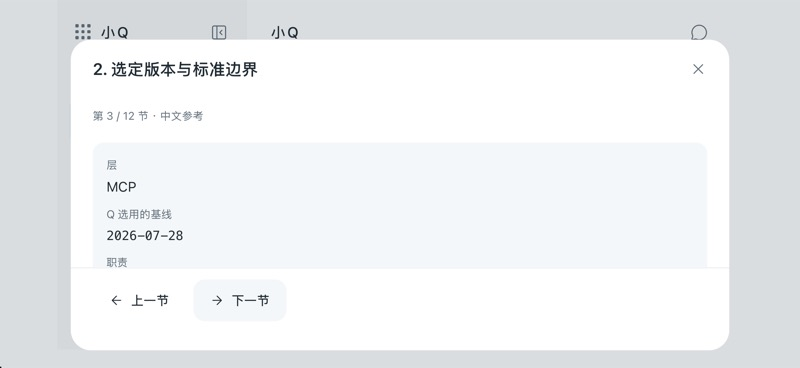
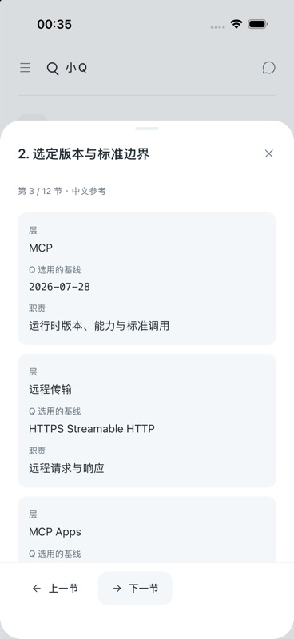
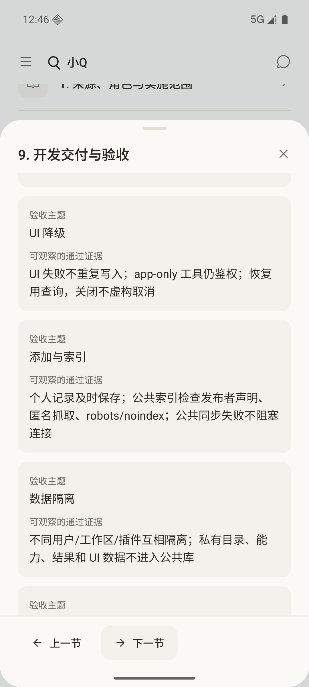
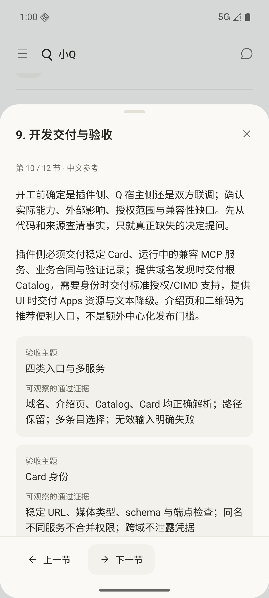
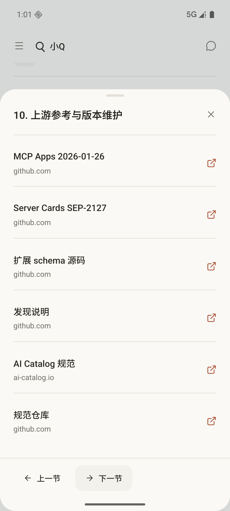
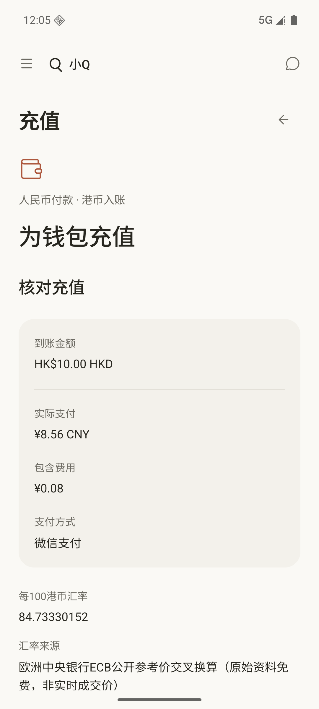
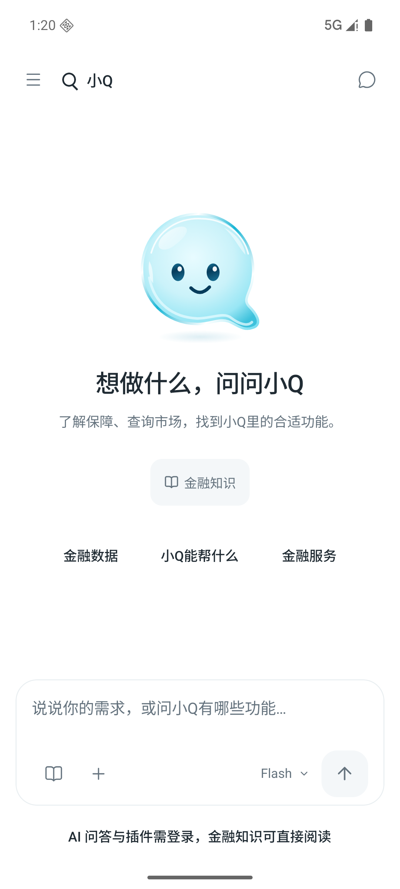
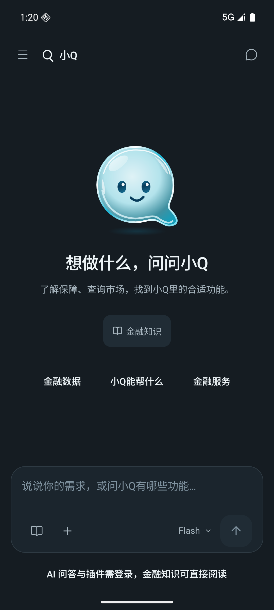
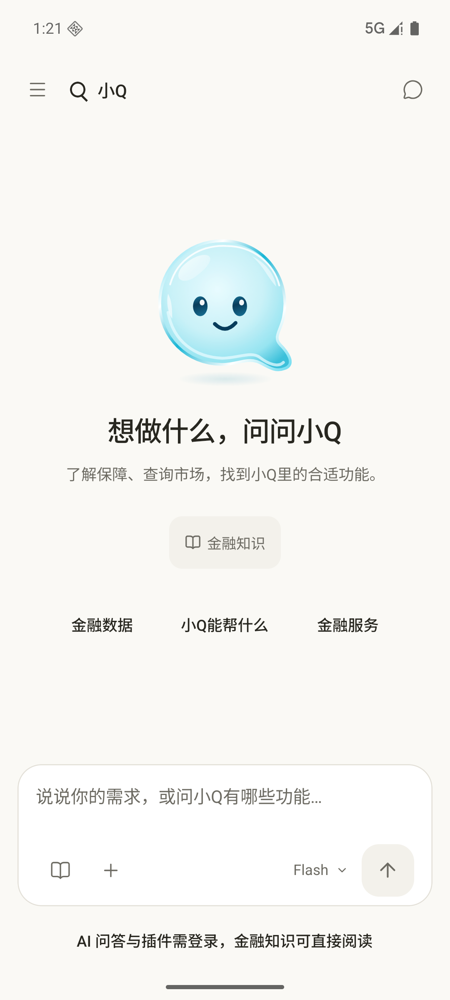
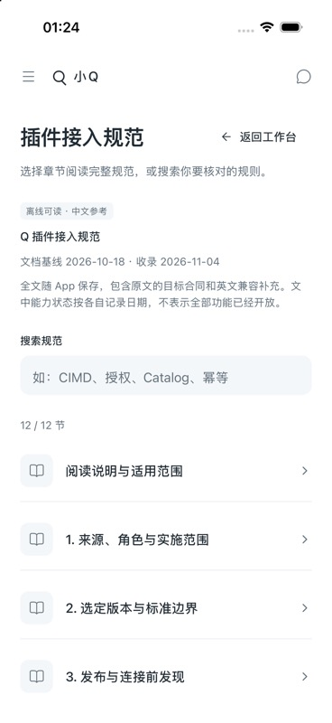

# 小Q完整回归与部署对齐记录（2026-11-04–05）

本轮从已合并的 GitHub main `4993ab0` 同步至 Mandow 后检查与修复。GitLab main `841a331` 与其代码树相同。本文是可重复的一轮全模块回归，不表示所有设备、供应商账号与真实资金闭环已穷尽。

## 已确认并修复

| 问题 | 根因及最终行为 | 验证 |
| --- | --- | --- |
| 浏览器公开资料查询立即报错 | 把原生 Window.fetch 当 options 的方法调用，导致 Illegal invocation；改为保持函数身份的独立调用 | 真实浏览器同源对照：旧调用 0ms 失败，裸调用 200；修后币价及 Apple 公司候选成功；原生查询保留 |
| 已知不支持的 Web 来源仍可反复触发失败 | Fed/SEC 没有允许网页直读的 CORS；查询前显示平台说明及官方来源，原生仍支持读取。公司 Web 搜索继续 Wikidata，SEC 明确“未请求”，不冒充空结果或成功；助手同样在缓存/冷却前检查能力 | 固定来源和平台测试；Wikidata 成功；受限来源不会发请求，重复助手请求不误提示冷却 |
| 静态 Web 首次加载出现 React #418 | 服务端尺寸 0 与浏览器尺寸导致侧栏/紧凑欢迎内容不同；用一致的首帧尺寸，水合后读取实际视口 | 真实 IAB 首屏无新 error；Safari 响应式 390/1280、759/760、579/580 与草稿保留实际检查 |
| 完整接入规范跳到私有 GitLab 登录 | 将权威规范全文随包保存，分章搜索、代码及表格可离线阅读；外链白名单与显式确认 | 原文 SHA 一致，12 节完整；匿名入口和原生打开、搜索已检查 |
| 长篇规范的翻章及返回位置错误 | QA 发现下一章沿用旧 scrollTop；仅重建内容滚动区，翻章归零、外链返回恢复位置；丢弃旧滚动与外链回调，保持同一个 Modal | 实际旧 Web scrollTop 1601.5 复现；真实 TSX 迟到事件回归及独立审查；真实 IAB：翻章 1601.5→0；外链取消 1244→1244，原生增量回归另列 |
| 三主题输入提示与选中小字对比度不足 | 调整5个语义色常量，保持原色系；占位文字与所测小字配对达到4.5:1 | 旧三主题公式回归3/3失败，修后3/3通过；[W3C对比度说明](https://www.w3.org/WAI/WCAG22/Understanding/contrast-minimum.html)。仅证明列明配对，不是全App AA认证 |
| 充值核价页返回标注“返回钱包”，实际返回编辑 | 按真实状态显示“返回修改”，保留金额与支付方式 | 微信 HKD10、支付宝 HKD50000 报价及返回修改；未创建付款订单 |
| iOS 弹窗旋转与 App 方向不一致 | RN Modal 默认只支持 portrait；现在遵守 App Info.plist 已允许的四个方向 | 模块源码与实际原生表现交叉核对；最终 iOS 模拟器新包在弹窗打开时 800×368→368×800，按钮与正文可见，已恢复竖屏 |

相应能力文档也已纠正：支付、云端聊天历史、应用助手、金融目录和可信代理已部署，不能继续写成“新版后端未部署”。没有修改协作或权限规则。

## 自动化与线上检查

- 移动端：类型、lint、8 组功能测试 **612 项**及 production Web 导出。修复过程中初次 mock 接口缺失、reader render 读 ref 的检查失败均保留原日志，并修复后复验，不计为通过。
- 后端：默认及完整功能 clippy、普通测试各 94 项；全功能集成测试在新建独立 PostgreSQL 17.10 中 95 项通过（含支付、社交与真实备份恢复）。集成与备份恢复只使用临时测试库，不在原有本地或线上业务库执行这些集成测试或账本写入。
- 管理 Web：类型/lint/build、17 项单元、17 项浏览器测试通过；这覆盖静态演示，不代表真实管理接口已接通。
- 部署工具：208 项 Python 检查通过，无最终跳过；真实 age、pg_dump/restore、两套 Nginx 配置与 Shell 语法检查通过。首次缺 age 的跳过日志保留，补齐工具后已重跑。
- 线上：17 项已认证只读接口均 200；9 项未登录私有接口均按合同返回 401/UNAUTHORIZED。一次最短 Flash 测试完整收到 status/delta/done，无 error；独立会话已注销。线上授权冒烟及 GUI 涉及测试账号的会话、报价、短暂偏好切换及 AI 调用；偏好已还原，本轮未新增付款订单、转账、入账或好友消息。

## 仓库、服务器、安装包与本机路径

- 服务器仍运行已审核 `ac920275` 制品；实际二进制、9 项迁移校验一致，API/PostgreSQL/网关 healthy，所查 24 小时日志没有 WARN/ERROR，健康及备份计时器正常。
- `ac920275` 到本轮已合并 main 的 backend 业务、依赖、迁移、合同及 web 源码没有遗漏部署差异。提交号不同本身不是功能未部署证据。
- 已交付 APK `f820…`、已上传 IPA `55b…` 都连接 `https://q.kaicloudpay.com`，EXConstants 为 public，无 hostUri；21 项静态资源齐全。没有发现业务依赖开发机 localhost、局域网或 `/Users/` 的路径。
- IPA 中存在构建来源的 `/Users/.../main.jsbundle` 调试元数据；没有发现按此地址加载功能。正常包内 file URI 和本地媒体资源可离线使用，不等于读取开发者电脑。
- 初始 iOS QA 模拟器仍是构建 4，本轮已覆盖更新到构建 5并保留原账号与模拟账户。审计候选是当前修复的独立测试制品，不能回标到此前冻结 APK/IPA；原交付 APK 保持原哈希。

## 当前未通过项与仍未完成能力

- **GDELT 金融新闻未通过**：IAB 正常查询实际 10 秒超时。两次本机独立探针分别为 TLS 建连超时、约 9.58 秒收到 HTTP429；同参数服务器探针在 TCP 建连阶段 8 秒超时，未取得新闻 JSON。Mac 系统代理与 curl 出口未证明相同，不能据此锁定 IAB 的单一根因、查询过重或解析错误。没有扩大超时假称修复、放宽 HTTPS、使用开放代理或替换来源。正常响应的跨域能力与限流机制见 [GDELT DOC 规范](https://blog.gdeltproject.org/gdelt-doc-2-0-api-debuts/)和[限流说明](https://blog.gdeltproject.org/ukraine-api-rate-limiting-web-ngrams-3-0/)。需来源/出站连接恢复后，取得可验证 JSON 才能关闭此项。

1. 支付汇率仍为运维快照，**2026-11-06 22:56:38（北京时间）到期，尚无自动刷新**；到期后新报价按既有规则关闭。当前报价可用。本轮未改变汇率配置、手续费、限额或审批权限。
2. `/q-admin/` 仍是静态演示，真实资金审批界面尚未实现；这是实现缺口，不能通过重复部署静态页面解决。
3. TestFlight 构建 5 已获 Apple 上传接收，但公开测试组分发/审核/下载版本仍未完成账号验证。本轮未上传新构建或宣称公测已更新。
4. 未执行真实付款、双人审批入账、提款清算、付费视频生成、第三方个人 OAuth/密钥授权或对外好友消息。模拟银行仍是独立演示账本；供应商账号权限不由界面或本次测试代替。
5. 实际设备只覆盖指定模拟器；物理设备、其他 Android/iOS 版本、平板以及真实 16KB 系统运行未穷尽。16KB 静态对齐检查不等于真机验收。

## 实际交互与制品

| 范围 | 本轮实际检查 | 边界 |
| --- | --- | --- |
| 登录、聊天、历史 | 登录/退出、模型与14模块说明、键盘/未发送草稿、空历史读取 | 没有向朋友发送消息；已有私人历史保留 |
| 支付钱包 | 余额、待处理/历史空态、HKD10微信与HKD50000支付宝报价、返回修改、提现联系方式 | 没有创建收银台或付款 |
| 银行与金融插件 | 20家银行目录、6家金融说明、已有连接状态及空模拟钱包 | 不造新模拟卡/资金，不做个人供应商授权 |
| 公开资料 | 原生BTC、美联储、SEC/Wikidata搜索及财报页面；Web BTC/Wikidata成功和受限来源提示 | GDELT单列未通过，不能概括全部来源全绿 |
| 工作台与规范 | 连接表单、完整规范入口、搜索CIMD、章节/表格、Web翻章与外链取消阅读位置 | 外部标准只确认取消，不提交插件或新授权 |
| 保险、分期、理财 | 目录/详情/本地对比与撤销、指南、演示及未接入说明 | 不投保、不购买 |
| 视频与API工作台 | 本地原片播放/暂停、设置、空连接/任务、添加连接表单与取消 | 不保存真实key、不发付费生成 |
| 社交与资料 | 三个空列表、好友输入不提交、昵称/简介编辑取消、三主题/中英切换后还原 | 不加好友、不修改账号或发送消息 |
| 布局 | Safari真实响应式390/1280、759/760、579/580；草稿跨布局保留并清理；iOS弹窗横竖屏 | IAB虚拟视口未改变实际尺寸的尝试已排除，不冒充断点通过 |

**32ff行为审计 APK（调色前）**：`0.1.0 (5)`，arm64，SHA256 `32ff4b3c563a5a043fcf32e3d06404e99a344723e270a11b860a084df3126361`，42,211,506字节。原签名、public API、无悬浮窗权限、ZIP与25个ELF的16KB静态对齐通过；逐个解压条目未匹配本任务6个已知凭据（含UTF8/UTF16LE/base64变体）。这只是私有测试候选，不是Google Play发行，原`f820…`交付文件保持不变。

**59e77行为审计 iOS 模拟器（调色前）**：`0.1.0 (5)`，JS SHA256 `59e77b333483606fc79387110c84eb3a8b10a65c50617874671d7d51bd0d4589`；EXConstants public/HTTPS、无hostUri。它与此前已上传 Apple 的`55b…` IPA分别冻结，本轮没有再次上传 TestFlight。

两平台使用当前工作区修复，基线`4993ab0`；Android冻结337项输入的 fingerprint为`91ac8224d77573df2e1e5f5a43a2098280991d402e6ea2ac26bb6c1b9e0ae359`，构建后逐字节无漂移。新增加的本记录与截图是文档，不是安装包运行输入。

32ff候选的14模块组、指南及共享弹层行为回归通过；随后仅5色变化，最终f64候选三主题及未登录Sheet键盘增量复验通过。Android已恢复未登录、空草稿、原旋转与IME设置，QA账号warm/zh偏好还原，未修改昵称/简介；iOS保留原登录并恢复竖屏首页。未发现本轮本App崩溃记录。

**最终调色测试APK**：`0.1.0 (5)`，arm64，42,211,734字节；SHA256 `f64fd918691f9907bb45c6028a74aee8e0c83918eb183268f8d16771ab2e38d9`。签名、public API、权限、16KB静态对齐及6个已知凭据逐条目扫描均通过。338项冻结输入fingerprint：`94cfd37c075f36cc42ca17f3e001379c3b573ce0fcd780f91281bdd123246e56`。本报告目录属于审计输出，已明确排除运行输入；其他源码/资源/配置/锁和测试均照录。

**最终调色iOS模拟器**：仍为`0.1.0 (5)`，JS SHA256 `952694939d7c00ee90f0964cd8dcb0b941967d9be107d6060ca81568f150a381`；仅供本轮QA，不是重新上传的IPA。

以下Android行为截图分别来自9f5/32ff候选（调色前），已逐张目视核对，无账号、密钥或私人聊天。

| 翻章修复前（继承中段） | 修复后（从首段开始） |
| --- | --- |
|  |  |

最终调色候选的三主题原始截图（无登录身份）：

| 浅色 | 深色 | 暖纸 |
| --- | --- | --- |
|  |  |  |

## 验证证据

详细原始日志、输入哈希、只读线上状态与全部测试截图保存在任务工作区的`.local/full-audit-20261104/`，不把凭据或完整业务日志入库。移动端最终检查为`mobile/contrast-final/`；后端/Web为`backend-web/RESULT.json`；服务器审计为`deployment/`；包路径/资源为`paths/`；候选与GUI分别为`android-final/`、`android-qa/`；GDELT失败证据单列`gdelt-diagnostics/`。

参考[现部署记录](../../../backend/deploy/STATUS.md)、[此前安装包记录](../mobile-release-2026-11-04/README.md)。提交后继续以MR/PR最新源提交的实际流水线结果为准，保留人工审核合并，不自动发布或部署。
