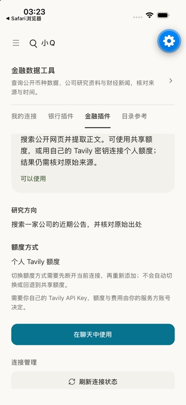
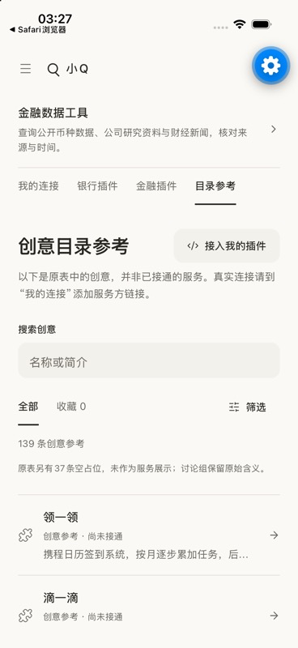

# 插件额度模式与连接恢复

2026-11-15。以 GitHub main `21e9459` 开始，保留同期青色强调与错误红色规则。期间开发分支新增已提交的旧视频/广场/分期入口下线改动`659d8c2`，集成时保留并重新验证移动端；后端、插件实现和合同文件与独立审查版本一致。本文记录源码与独立验证，不表示服务器或手机安装包已更新。

## 本批范围

- Tavily 默认保留共享额度，可明确选择个人 API Key；目录按能力宣告显示入口，个人模式缺密钥或失败不会降级匿名。模式切换须先断开，保留历史并隔离旧版本。
- 金融接口404区分目录缺失、连接删除和授权记录失效；服务更新可以直接定位该账号的连接详情。FRED只管理更新并返回临时研究，不开放普通聊天、工具或历史入口。
- 参考目录按139条创意参考计数，37条空占位与原始ID、讨论组及内容保留；收藏仍明确仅在当前预览内。
- 推荐中的Tavily个人连接显示个人额度；其他账号不可见，切换模式后旧推荐不能承接。推荐开关没有启用。

没有增加依赖、SQL迁移、公共爬取索引、MCP Apps、历史归档、多插件项目编排或真实银行接入。个人模式需要新版客户端准确管理，旧金融详情的静态共享文案无法由服务端纠正；回退旧后端前须禁用个人路径。合同见[API说明](../../backend/contracts/api.md)与[金融插件](financial-plugins.md)。

## 自动验证

| 范围 | 实际结果 |
| --- | --- |
| 移动端类型、lint、Web导出 | 全部通过 |
| 移动端八组功能测试 | 集成后766项，0失败/跳过：utils34、video10、plugins137、api-workbench16、account44、social33、chat440、payments52；本批独立集成前为762项 |
| Rust | fmt、默认及all-features all-targets Clippy通过；默认库测试132项与迁移单测3项通过；默认忽略的数据库用例未算作默认通过 |
| 原文运行时回归 | all-features下filing_research 5项通过 |
| 独立PostgreSQL17.10 | postgres9、account_lifecycle10、ai_history3、social15、video_workbench5、ai_chat8、plugins12、ai_plugins5、financial_plugins15、recommendations10，共92项通过；另显式执行受信只读并发专项1项通过 |
| API合同 | OpenAPI再生共享类型，无手改生成文件 |

数据库仅在本机回环55443，测试与界面库分别为`q_plugin_test_20261115`、`q_plugin_ui_20261115`，各用独立schema；不使用本地55432或线上业务库。新增回归覆盖旧添加请求、显式/并发模式冲突、跨账号凭据、401无匿名fallback、旋转和撤销、未知调用不重放、推荐版本失效，以及跨设备模式变化后的界面恢复。

独立review发现并修复：新客户端刷新连接后仍继承旧额度模式。修复后每次Tavily连接返回重读权威目录并核对连接ID/版本；发生跨设备变化时显示最新状态并停止本次进入聊天。独立组件复现及39项定向检查通过，无遗留P1/P2。随后与入口下线提交的集成复核通过，定向推荐8项通过。旧客户端展示限制也已同步合同。最终提交与两端流水线以各审核页的最新提交为准。

## 已观察到的远端检查

源码集成提交`2840b82e5f3593d211aec4c780391bcc65c81c0f`的[GitHub分支检查](https://github.com/ZoD-Q/Q/actions/runs/43632578660)和[PR检查](https://github.com/ZoD-Q/Q/actions/runs/43632582909)已实际全部通过，含PostgreSQL17/18及ci-check。后续说明提交的最新结果仍以审核页对应提交为准，不沿用旧提交结果。

## iOS原生验证

专用 Q Recommendations QA 模拟器、iOS26.5、Expo Go58，以`Q_LOCAL_API_TEST=1`连接本机Rust预览18879和独立数据库；只使用公开demo账号、`fixture-personal-key`及固定供应商回环替身。预览示例为`backend/examples/plugin_access_preview.rs`，AI/OAuth未启用。它隔离本轮固定供应商路径，不是整个进程断网；未操作通用公开发现或原文接口。

已实际查看暖纸主题八家目录、Tavily共享/个人选择；个人连接先显示需要授权，输入替身密钥后实际Rust加密保存并取得回环工具目录，显示个人额度与可用状态。重新打开更换密钥弹层时输入已清空、保存按钮禁用。明确断开后重新选择共享模式，读取回环工具目录并显示共享额度；参考目录的139条计数、37条空占位说明及未接通标识也已实际检查。独立UI库复核显示最终共享连接、0条个人凭据、0次业务调用记录，证明切换后的旧凭据已清除，未触发搜索业务。没有把这些UI验证称为真实Tavily授权或搜索验收。

Android、真机、最大字体及全部主题/语言组合本轮未逐一原生验收。跨账号/后台迟到响应和FRED更新隔离由组件及服务端测试覆盖。

## 真实服务与后续边界

- 本轮使用正式网络约束运行匿名CoinGecko Rust探针，返回`MCP_TIMEOUT`；个人MCP公开授权元数据多条规范路径也未完成TLS读取。保留失败，不猜测认证发行者、不将API Key当成OAuth token、不放宽证书或网络限制。个人通道未实现。
- Tavily个人额度的凭据与调用隔离已通过回环替身和独立数据库；没有取得真实个人Tavily密钥，不宣称已通过供应商个人额度业务验收。
- 同花顺官方账号经用户本人登录显示试用权益；企业报价咨询由用户在官网完成验证并提交，页面确认客服经理后续联系。企业申请不是面向小Q全部终端用户的授权，也不是已报价或已签约。平台集中凭据、用户级额度及新账号自动使用，需官方确认适用范围后单独实施；本轮未将试用密钥复制或配置给全部账号。企业与联系人信息、验证码和密钥不进入本仓库。
- 线上推荐仍保持关闭；未部署、未发包、未付款、未执行真实转账、未自动合并。
